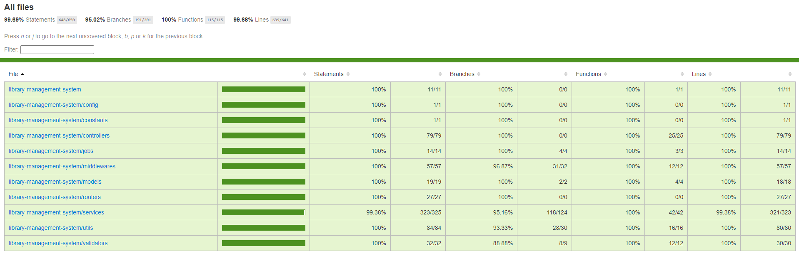

# Library Management API 📚

A RESTful library management API built with Node.js, Express, and MongoDB, featuring JWT authentication, role-based access control (RBAC), transactional data integrity, book inventory, loans, reservations, scheduled jobs, and automated testing.

## 🔗 Links

- **[Live API](https://library-management-api-w0r6.onrender.com)** — Access the deployed API.
- **[Interactive API Documentation](https://library-management-api-w0r6.onrender.com/reference)** — Explore and test endpoints.
- **[OpenAPI Specification](https://library-management-api-w0r6.onrender.com/openapi.json)** — View the API specification.

## ✨ Features

### 🔐 Authentication & User Management

- User registration and login with JWT authentication
- Access and refresh token management
- Password hashing and password change functionality
- Role-based access control (RBAC)
- User profile management and input validation
- Account activation and deactivation

### 📚 Book Management

- Create, update, activate, and deactivate books
- Search by title and author, with filtering and sorting
- Pagination for book listings
- ISBN validation
- Book cover uploads using Cloudinary
- Track total and available copies
- Prevent invalid inventory updates when books are borrowed

### 📖 Loan Management

- Manage book borrowing and returns
- Track loan due dates and statuses
- Automatically identify overdue loans through scheduled jobs
- Calculate and store late-return fines when books are returned
- Apply a fine rate of **15 EGP per overdue calendar day**
- Maintain book availability throughout the loan lifecycle

### 📋 Reservation Management

- Create and manage book reservations
- Maintain reservation queue order
- Manage reservation approval and pickup deadlines
- Automatically expire reservations that exceed their pickup deadlines
- Promote the next eligible reservation when a copy becomes available
- Keep reservation and book availability updates consistent

### ⚙️ Data Integrity & Background Jobs

- MongoDB transactions for operations involving multiple related documents
- Conditional database updates to help prevent conflicting concurrent modifications
- Scheduled jobs for reservation expiration and overdue loan status updates
- Centralized error handling for application and database errors
- Request validation and business-rule enforcement

### 🧪 Automated Testing

- Integration tests for API endpoints and business workflows
- Unit tests for authentication, middleware, utilities, and validators
- Tests for user and book management, loans, and reservations
- Error-handling, authorization, and failure-scenario testing
- Coverage reporting using Vitest and V8

## 📊 Test Coverage

The project maintains comprehensive test coverage across business logic, authentication, middleware, utilities, and API workflows.



| Metric     | Coverage |
| ---------- | -------: |
| Statements |   99.69% |
| Branches   |   95.02% |
| Functions  |     100% |
| Lines      |   99.68% |

## 🛠️ Tech Stack

### Backend

- Node.js
- Express.js
- JavaScript (ES Modules)
- MongoDB
- Mongoose

### Authentication & Validation

- JSON Web Tokens (JWT)
- bcrypt
- express-validator
- validator

### File Uploads & Scheduling

- Multer
- Cloudinary
- file-type
- node-cron
- Luxon

### Testing

- Vitest
- Supertest
- MongoDB Memory Server
- V8 coverage reporting

## 🏗️ Architecture

The application uses a modular architecture that separates HTTP handling, business logic, data models, and shared functionality.

- `config/` — Application configuration
- `constants/` — Shared constants
- `controllers/` — Request handling and HTTP responses
- `jobs/` — Scheduled background tasks
- `middlewares/` — Authentication, authorization, validation, and error handling
- `models/` — Mongoose schemas and models
- `routers/` — API route definitions
- `services/` — Business logic and database operations
- `tests/` — Unit and integration tests
- `utils/` — Reusable helper functions
- `validators/` — Request validation rules

## 📡 API Overview

The API is organized into resource-based routes:

| Base Path           | Description                                               |
| ------------------- | --------------------------------------------------------- |
| `/api/auth`         | Registration, login, token management, and authentication |
| `/api/users`        | User management and profile operations                    |
| `/api/books`        | Book catalog and inventory management                     |
| `/api/loans`        | Book borrowing, returns, and loan management              |
| `/api/reservations` | Reservation management and queue workflows                |

Protected endpoints require authentication, while administrative operations use role-based authorization.

## 🚀 Getting Started

### Prerequisites

- Node.js and npm
- MongoDB instance or MongoDB Atlas account
- Cloudinary account for book cover uploads

### Installation

Clone the repository and install its dependencies:

```bash
git clone https://github.com/ahmedzeyad67/library-management-system.git
cd library-management-system
npm install
```

### Environment Variables

Create a `.env` file in the project root and configure the required environment variables.

At minimum, the application requires a MongoDB connection string and supports a configurable server port:

```env
MONGO_URI=your_mongodb_connection_string
PORT=3000
```

Also configure the JWT secrets and Cloudinary credentials required by the application's authentication and image-upload configuration.

**Never commit your `.env` file or expose secrets in the repository.**

### Run the Server

Start the application:

```bash
npm start
```

The server connects to MongoDB, starts the scheduled jobs, and listens for incoming requests. The default port is `3000` when `PORT` is not set.

## 🧪 Running Tests

Run the complete test suite:

```bash
npm test
```

Run tests in watch mode:

```bash
npm run test:watch
```

Generate a test coverage report:

```bash
npm run test:coverage
```

The test suite covers API behavior, authentication, authorization, business rules, data consistency, middleware, utilities, and important failure scenarios.

## 🎯 Project Focus

This project emphasizes backend engineering fundamentals, including secure authentication, role-based authorization, transactional data integrity, concurrency handling, scheduled background tasks, and comprehensive automated testing.
